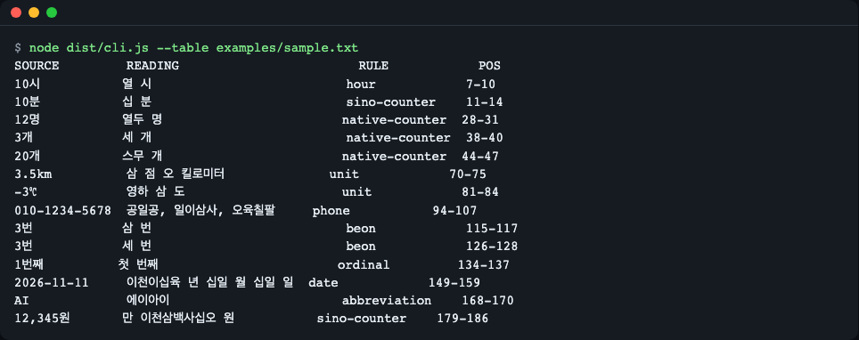
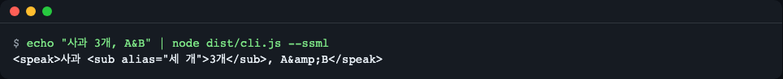
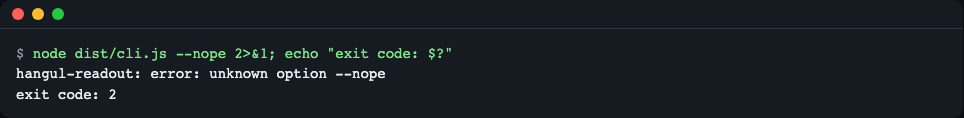
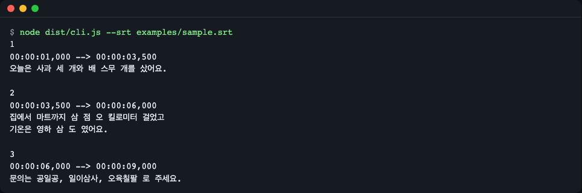
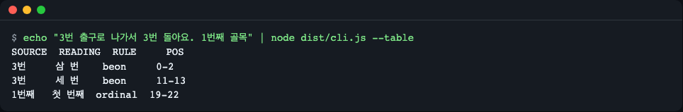
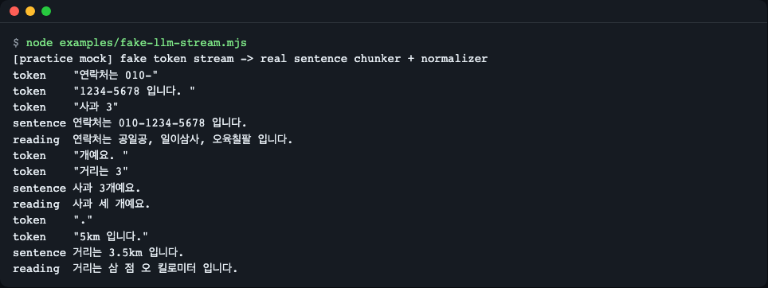
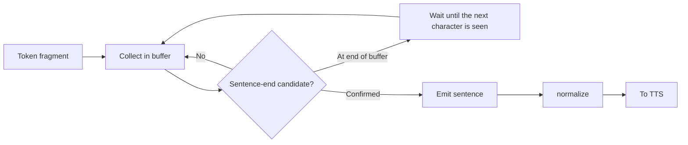

# hangul-readout

[한국어](README.md) | **English**

A zero-dependency TypeScript library and CLI that rewrites Korean text the way a person reads it aloud, right before it goes to a TTS engine: `사과 3개` becomes `사과 세 개`, `3.5km` becomes `삼 점 오 킬로미터`, `010-1234-5678` becomes `공일공, 일이삼사, 오육칠팔`.
It reports which spans changed (offsets in the original text and in the output), can emit SSML `<sub alias>`, and ships a sentence chunker so streaming LLM tokens such as `3` / `.` / `5km` are never misread.
Install: `npm install github:LeeGyeongPil/hangul-readout` (Node >= 22.12, ESM only). Minimal use: `import { normalize } from "hangul-readout"; normalize("사과 3개").text`.

## 1. Introduction

A library for people building Korean voice apps, voice agents or narration automation in JS/TS. Right **before** a string is handed to TTS, it turns numbers, units and dates into "spoken words". It has no runtime dependencies and runs offline, with no keys, network or GPU.

## 2. What it does

TTS engines read numbers and units differently from one another. One reads `3개` as "삼 개" (sam gae), another reads `100kg` as "백 케이지" (baek ke-i-ji). This library rewrites the text before it reaches the engine. It is like a proofreader penciling "read this as ..." onto a script for the narrator. The script (the subtitles) stays untouched; only the reading is written down separately.

| Original | Reading by this library | Why |
|---|---|---|
| 사과 3개 | 사과 세 개 | The counter `개` takes a native Korean numeral |
| 3년 | 삼 년 | The counter `년` takes a Sino-Korean numeral |
| 3.5km | 삼 점 오 킬로미터 | Decimal number with a unit |
| 2.5배 | 이 점 오 배 | Decimal number with a counter |
| -3℃ | 영하 삼 도 | Negative temperature |
| 010-1234-5678 | 공일공, 일이삼사, 오육칠팔 | Phone numbers are read digit by digit, with 0 as "공" |
| 2026-11-11 | 이천이십육 년 십일 월 십일 일 | Date |
| 3번 출구 / 3번 눌러 | 삼 번 출구 / 세 번 눌러 | `번` depends on whether it means a number or a count of times |



*Output of `node dist/cli.js --table examples/sample.txt`. It shows only the spots that changed in the sample file, as a table.*

## 3. Quick start

Install it. Node 22.12 or later is required (to install the prerequisites, for example: macOS `brew install node`, Debian/Ubuntu `sudo apt-get install -y nodejs npm git`).

```bash
npm install github:LeeGyeongPil/hangul-readout
```

Publishing to the npm registry is prepared but not done yet (once published: `npm install hangul-readout`). The `prepare` script builds `dist/` during installation, so a git install can be imported right away. On npm 11 and later you may see a warning that the `prepare` script is not yet in `allowScripts`. This is not an install failure; the build still runs and the package can be imported immediately.

```js
import { normalize } from "hangul-readout";

const { text, spans } = normalize("사과 3개를 사서 3.5km를 걸었어요. 문의는 010-1234-5678");
console.log(text);
```

```text
사과 세 개를 사서 삼 점 오 킬로미터를 걸었어요. 문의는 공일공, 일이삼사, 오육칠팔
```

Pass `text` to TTS, and keep using the original string for the subtitles shown on screen. You can also use it from the command line inside a project where it is installed.

```bash
echo "사과 3개" | npx hangul-readout
```

```text
사과 세 개
```

To clone the repository and try it yourself, run the following (from install to the table output takes a few minutes).

```bash
git clone https://github.com/LeeGyeongPil/hangul-readout.git
cd hangul-readout
npm ci
npm start
```

`npm start` builds the project and prints the change table for `examples/sample.txt`. The screenshot above is that result.

## 4. Usage

### 4.1 `normalize` and spans

`normalize(text, opts?)` returns `{ text, spans }`. `spans` is a list of "what changed where in the original".

```js
import { normalize } from "hangul-readout";

const r = normalize("사과 3개와 배 20개");
console.log(r.text);
console.log(JSON.stringify(r.spans[0]));
```

```text
사과 세 개와 배 스무 개
{"start":3,"end":5,"outStart":3,"outEnd":6,"source":"3개","reading":"세 개","rule":"native-counter"}
```

- `start`/`end`: position in the original text (UTF-16 offsets, the same unit as `String.prototype.slice`).
- `outStart`/`outEnd`: position in the resulting `text`.
- `source`/`reading`: the text before the change and its reading. `rule`: which rule made the choice.

It never throws for any string (empty string, emoji, very long numbers). Passing a non-string throws a `HangulReadoutError` (`normalize(null)` → `normalize(): expected a string, got null.`).

### 4.2 `toSSML`

For cloud TTS services that accept SSML (XML for speech synthesis). It wraps each changed spot in `<sub alias="reading">original</sub>`. `& < > " '` are escaped.

```js
import { toSSML } from "hangul-readout";
console.log(toSSML("사과 3개"));
```

```text
<speak>사과 <sub alias="세 개">3개</sub></speak>
```



*The original is kept and only the sound changes. `&` becomes `&amp;` as XML requires.*

### 4.3 `sentences` and `normalizeStream` (LLM streams)

An LLM sends its answer as token fragments. A split can land in the middle of a number, such as `3` / `.` / `5km`. `sentences` collects fragments and emits them **only after a sentence is confirmed**, and `normalizeStream` adds `normalize` on top of that. The input is an `AsyncIterable<string>` or an `Iterable<string>`.

```js
import { sentences, normalizeStream } from "hangul-readout";

const tokens = ["거리는 3", ".", "5km 입니다", ". 다음은 ", "사과 3", "개예요. 끝"];

for await (const s of sentences(tokens)) console.log(s);
for await (const s of normalizeStream(tokens)) console.log(s.text);
```

```text
거리는 3.5km 입니다.
다음은 사과 3개예요.
끝
거리는 삼 점 오 킬로미터 입니다.
다음은 사과 세 개예요.
끝
```

`normalizeStream` yields `{ sentence, text, spans }`. It uses no time-based flush (timeout), so the same input always produces the same result. How it works is explained in section 8.

### 4.4 `createNormalizer` and options

Build the options and rules once and reuse them many times. Each call uses only local state, so running several streams at the same time does not mix them up.

```js
import { createNormalizer } from "hangul-readout";

const n = createNormalizer({
  counters: { native: ["포기"] },
  abbreviations: { RAG: "래그" },
  units: { "㎡": "제곱미터" },
});
console.log(n.normalize("배추 3포기, RAG 30㎡").text);
```

```text
배추 세 포기, 래그 삼십 제곱미터
```

| Option | Default | Meaning |
|---|---|---|
| `over99` | `"mixed"` | How native-Korean counters read numbers of 100 and above (section 5) |
| `counters` | built-in table | `{ native?: string[]; sino?: string[] }` adds counters |
| `units` | built-in table | `{ "㎡": "제곱미터" }` unit symbol → reading |
| `abbreviations` | built-in table | `{ RAG: "래그" }` English abbreviation → reading |
| `beonNumberHints` | built-in list | Words that make a preceding `번` read as a number (Sino-Korean) |
| `disable` | none | Array of rule names to turn off |

The chunk options `minChars` (default 8) and `maxChars` (default 160) are used by `sentences` and `normalizeStream`. Long text with no whitespace at all is cut by force at `max(maxChars*8, 2048)` characters.

### 4.5 CLI

```text
hangul-readout [options] [file | -]
```

With no file, or with `-`, it reads standard input.

| Option | What it does |
|---|---|
| (none) | Prints the text rewritten as readings |
| `--json` | Prints `{ text, spans }` as JSON |
| `--table` | Prints a table of the changed spots (original, reading, rule, position) |
| `--ssml` | Prints `<sub alias>` SSML |
| `--srt` | Treats the input as SRT: keeps the index and timing lines and rewrites only the dialogue |
| `--over99 <m>` | `mixed` (default) or `sino` |
| `--debug` | Prints a stack trace on error |
| `--help`, `--version` | Help, version |

| Exit code | Meaning |
|---|---|
| 0 | Success (empty input is also success) |
| 2 | Every error: unknown option, missing file, invalid `--over99` value, malformed SRT, and so on |

Errors appear only as a single line on stderr (`hangul-readout: error: …`); a stack trace appears only with `--debug`.

```bash
node dist/cli.js --nope 2>&1; echo "exit code: $?"
```

```text
hangul-readout: error: unknown option --nope
exit code: 2
```



*An error case. Only one line is printed, with no traceback, and the exit code is 2.*

For SRT subtitle files, only the dialogue is rewritten as readings.

```bash
node dist/cli.js --srt examples/sample.srt
```

```text
1
00:00:01,000 --> 00:00:03,500
오늘은 사과 세 개와 배 스무 개를 샀어요.

2
00:00:03,500 --> 00:00:06,000
집에서 마트까지 삼 점 오 킬로미터 걸었고
기온은 영하 삼 도 였어요.

3
00:00:06,000 --> 00:00:09,000
문의는 공일공, 일이삼사, 오육칠팔 로 주세요.
```



*To save the result to a file: `npx hangul-readout --srt narration.srt > narration.read.srt`.*

## 5. Reading rules

The scanner sweeps the text from left to right, and when it meets a number it tries the rules below **from the top**. The first matching rule decides the reading, and if a rule declines ("this is not mine") the next rule is tried. So the order is how ambiguity gets resolved (phone numbers come before plain numbers).

| Order | Rule | Example → reading |
|---|---|---|
| 1 | `phone` | 010-1234-5678 → 공일공, 일이삼사, 오육칠팔 (also main numbers like 1588-1234, `(02) 123-4567`, `+82-10-…`, and the emergency number 119) |
| 2 | `date` | 2026-11-11 → 이천이십육 년 십일 월 십일 일, 11/11 → 십일 월 십일 일 |
| 3 | `protect` | 192.168.0.1, 1.2.3, `https://…` → left exactly as they are |
| 4 | `clock` | 3:30 → 세 시 삼십 분 |
| 5 | `ratio` | 16:9 → 십육 대 구, 1:1 → 일 대 일 |
| 6 | `fraction` | 1/3 → 삼분의 일 |
| 7 | `range` | 2~3명 → 두세 명, 5~6시 → 다섯 시에서 여섯 시, 30~40% → 삼십에서 사십 퍼센트 |
| 8 | `unit` | 3.5km → 삼 점 오 킬로미터, -3℃ → 영하 삼 도, 30°C → 삼십 도 |
| 9 | `currency` | $5 → 오 달러, ₩5000 → 오천 원, ₩5,000원 → 오천 원 |
| 10 | `month` | 6월 → 유월, 11월 → 십일 월 |
| 11 | `hour` | 10시 → 열 시 (`시간` is excluded) |
| 12 | `ordinal` | 1번째 → 첫 번째, 2번째 → 두 번째 |
| 13 | `beon` | 3번 출구 → 삼 번 출구 / 3번 눌러 → 세 번 눌러 |
| 14 | `native-counter` | 3개 → 세 개 |
| 15 | `sino-counter` | 3년 → 삼 년, 20세 → 이십 세, 제1장 → 제일 장, 30대 → 삼십 대. Decimals are read in Sino-Korean even before native counters: 1.5배 → 일 점 오 배, 2.5시간 → 이 점 오 시간 |
| 16 | `digits` | Digit strings of 17 or more digits, or starting with 0 → one digit at a time |
| 17 | `number` | 12,345 → 만 이천삼백사십오 |
| - | `abbreviation` | AI → 에이아이, 5G → 파이브지 |

**Whether a number is native or Sino-Korean is decided by the counter that follows, not by the number.** `3개` is "세 개" and `3년` is "삼 년". That is why a function that merely converts numbers cannot process a sentence; the counter after the number has to be looked at too.

**The over-99 option.** There is no single correct way to read 100 and above with native Korean numerals, so it is chosen by an option.

```js
import { normalize } from "hangul-readout";
console.log(normalize("120명").text, normalize("120명", { over99: "sino" }).text);
```

```text
백스무 명 백이십 명
```

A few exceptions are built into the rules as well.

```js
console.log(normalize("6월 10월 11월").text, normalize("3시간 3시").text);
console.log(normalize("A4 용지 3장 COVID-19").text);
```

```text
유월 시월 십일 월 세 시간 세 시
A4 용지 세 장 COVID-19
```

- `6월` and `10월` are read "유월" and "시월".
- The `3` in `3시간` is "세"; since `시간` is the unit, the counter rule handles it rather than the `hour` rule.
- Numbers attached to English letters (`A4`, `MP3`, `COVID-19`, `v2.0`) are left alone. For `5G`, `3D` and `4K`, where the number comes first, the whole token is read if it is in the abbreviation table (`5G` → 파이브지) and left whole as it is if not (`1st`, `1e5`). Half of a token is never converted.
- `제1장` → 제일 장, `20대` → 이십 대, `2대` (vehicles) → 두 대. `제` followed by a number is Sino-Korean, and a multiple of 10 followed by `대` is read as an age group.
- A range is read only when both sides share the same counter or unit (`5~6시` → 다섯 시에서 여섯 시); if it cannot be read, it is left whole as it is, like `1~2.5명`.

```js
console.log(normalize("5~6시 30~40% 1~2만 원").text);
console.log(normalize("30°C 5G $5 11/11 16:9").text);
console.log(normalize("1588-1234 (02) 123-4567 +82-10-1234-5678").text);
```

```text
다섯 시에서 여섯 시 삼십에서 사십 퍼센트 일에서 이만 원
삼십 도 파이브지 오 달러 십일 월 십일 일 십육 대 구
일오팔팔, 일이삼사 (공이), 일이삼, 사오육칠 플러스 팔이, 일공, 일이삼사, 오육칠팔
```

`번` is decided by context. If a number-hint word follows it right away (출구, 버스, 선, 게이트, 트랙, 승강장, 홈, 문제, 채널, 방, 국도, 타자, 라인), or if it is preceded by `호선`, `번호는` or `정답은`, it is read as a number (Sino-Korean); otherwise it is read as a count of times (native Korean).



*`3번 출구` becomes "삼 번", `3번 돌아요` becomes "세 번", and `1번째` becomes "첫 번째".*

## 6. Adding your own rules

Options passed to `normalize` and `createNormalizer` are added on top of the built-in tables.

```js
import { normalize } from "hangul-readout";

console.log(normalize("3번 주차장").text);
console.log(normalize("3번 주차장", { beonNumberHints: ["주차장"] }).text);
console.log(normalize("AI 모델", { disable: ["abbreviation"] }).text);
```

```text
세 번 주차장
삼 번 주차장
AI 모델
```

- `counters`: adds counters as native or Sino-Korean (`{ native: ["포기"] }`).
- `units`: adds unit symbols (`{ "㎡": "제곱미터" }`).
- `abbreviations`: adds abbreviations (`{ RAG: "래그" }`). Matching is case-sensitive.
- `beonNumberHints`: adds words that make `번` read as a number.
- `disable`: turns off a rule when given its name (`RuleName`). The names are `phone`, `date`, `protect`, `clock`, `ratio`, `fraction`, `range`, `unit`, `currency`, `month`, `hour`, `ordinal`, `beon`, `native-counter`, `sino-counter`, `digits`, `number` and `abbreviation`.
- Keys of `abbreviations` may start with a digit, as in `{ "6G": "식스지" }`.

If you find an ambiguous sentence, you can also pin it by adding one more line to `test/golden.json` (section 11).

## 7. Aligning original and reading (spans) and subtitles

When you want to use the reading for audio and the original for the screen, spans connect the two strings. A span is a correspondence table: "this stretch of the original is that stretch of the reading", and the `<sub alias>` in `toSSML` expresses the same idea in XML.

Offsets are in UTF-16 code units. An emoji takes two units, yet `input.slice(start, end)` still gives exactly `source`.

```js
import { normalize } from "hangul-readout";

const input = "👍 사과 3개";
const e = normalize(input);
const s = e.spans[0];
console.log(JSON.stringify(s));
console.log(input.slice(s.start, s.end), "->", e.text.slice(s.outStart, s.outEnd));
```

```text
{"start":6,"end":8,"outStart":6,"outEnd":9,"source":"3개","reading":"세 개","rule":"native-counter"}
3개 -> 세 개
```

Why `start` is 6: the emoji 👍 takes 2 units (two UTF-16 code units), then one space, `사과` takes 2, and one more space, so `3개` starts at position 6. Tests pin down that `slice` stays correct even with emoji, ZWJ sequences and unpaired surrogates mixed in.

Subtitle highlighting example: wrapping only the `[start, end)` stretch of the original in `<mark>` lets you show "where the reading changed" in the subtitles, and `outStart`/`outEnd` let you find the same spot in the string on the audio-timing side.

## 8. Streaming: how chunk boundaries are respected

> **This is a practice fake LLM stream.** `examples/fake-llm-stream.mjs` is not a real model; it is a practice (mock) example that emits fixed token fragments split in the middle of numbers. The sentence splitting and reading conversion are the real library code, and the output is what actually came out of the library. No real LLM or TTS calls are included in this repository's examples or tests.

```bash
node examples/fake-llm-stream.mjs
```

```text
[practice mock] fake token stream -> real sentence chunker + normalizer
token    "연락처는 010-"
token    "1234-5678 입니다. "
token    "사과 3"
sentence 연락처는 010-1234-5678 입니다.
reading  연락처는 공일공, 일이삼사, 오육칠팔 입니다.
token    "개예요. "
token    "거리는 3"
sentence 사과 3개예요.
reading  사과 세 개예요.
token    "."
token    "5km 입니다."
sentence 거리는 3.5km 입니다.
reading  거리는 삼 점 오 킬로미터 입니다.
```



*Even after `입니다. ` arrives, the sentence is not emitted immediately; the earlier sentence comes out only after the next token `사과 3` arrives.*



- **lookahead**: if a sentence-end candidate (`.`, `?`, `!`, etc.) is at the very end of the buffer, confirmation is deferred until the next character is seen. If a `.` follows `3` and then a `5` comes after it, you can tell it was a decimal point.
- **Decimal points and list numbers**: a period between digits (`3.5`) and a list number (`1. `) are not treated as sentence ends. Ellipses are not treated as boundaries either. A line break is always a sentence end.
- **`maxChars`**: if one sentence is too long, it is split by force at a comma or whitespace, but never inside a number or symbol token such as `010-1234-5678`, `3.5km` or `2~3명`.

```js
import { sentences } from "hangul-readout";

const text = "연락처는 010-1234-5678 이고, 거리는 3.5km, 인원은 2~3명입니다.";
const out = [];
for await (const s of sentences([text], { maxChars: 12 })) out.push(s);
console.log(JSON.stringify(out));
```

```text
["연락처는","010-1234-5678","이고, 거리는","3.5km, 인원은","2~3명입니다."]
```

However the tokens are split on the way in (even one character at a time), the same sentences come out. This property is pinned by tests. Normalizing only after a sentence is confirmed is the key to preventing misreadings at chunk boundaries.

## 9. Limits and ambiguous readings

Some readings have no single correct answer. Defaults are chosen, and they can be changed with options and the golden table.

- **`번`**: the default is a count of times (native Korean). The words that make it read as a number grow only through the hint list and `beonNumberHints`. `3번 방법` is read as a count of times.
- **No particle agreement**: even when the reading changes, the following particle is not changed. `3개를` → `세 개를` is right, but where the final consonant changes (`1명이` → `한 명이`, etc.) the particle is not adjusted to fit the reading.
- **Range counters**: `2~3명` → `두세 명` and `5~6시` → `다섯 시에서 여섯 시` work, but `2~3일` is read as `이에서 삼 일` (not the natural `이삼 일`). Ranges that cannot be read (`1~2.5명`, `01~02월`) are left whole as they are, and `2-3` with no hyphen tail is not treated as a range.
- **`대`**: when the actual count is exactly a multiple of 10 (10 to 90), as in `20대의 서버`, it is read as an age group. `2대`, `5대` and `100대` are vehicles (native Korean).
- **`NN/NN` that looks like a date**: it is a date only when both sides have two digits, month ≤ 12 and day ≤ 31. `1/2` and `3/4` are fractions.
- **Currency**: the symbol, the number and a directly attached name of the same currency are read together (`$5`, `₩5000`, `₩5,000원`, and `$5달러` reads the name only once). With a space, as in `₩5,000 원`, only the symbol and number are read and the following name is read separately, so the name comes out twice (`오천 원 원`). A currency name that differs from the symbol (`$5원`) is not absorbed (`오 달러원`).
- **Markdown symbols are not removed.** As in `**3**개` → `**세** 개`, a `*`, `_` or `` ` `` between a number and its counter is skipped when reading, but the symbol stays in the output. TTS may read `**` as "asterisk", so strip the symbols on the calling side.
- **Very long words**: text with no whitespace that exceeds `max(maxChars*8, 2048)` characters (long URLs, base64, etc.) is cut in the middle.
- **개월, 석 달, 인분**: old forms such as 석 달 and 넉 장 are not supported.
- **Units and abbreviations not in the dictionary**: the built-in tables are a small set of defaults. Words not in the table (such as `GPT-4`) are left as they are; add them with `units` and `abbreviations`.
- **Whitespace and line breaks**: a single space before a unit is allowed (`5 km`), but two or more spaces or a line break are not joined.
- **Date notation and versions**: versions and IPs such as `1.2.3` and `192.168.0.1`, and URLs, are left whole as they are. A date with spaces in it, like `2026. 11. 11.`, may be cut at `2026.` in a stream.
- Some ambiguous readings (`3대 1` → `세 대 일`) are a limit of rule-based processing.
- It does no pronunciation conversion (liaison, tensification), no Hanja readings and no morphological analysis.
- The examples, tests (279) and typecheck passed on Node 22.12.0 and 26.13.0, and the CI matrix (22, 24, 26) keeps checking them.
- **Known limits (awaiting a code fix)**: some combinations of the `~` and `-` range symbols are not read as ranges or are read awkwardly. Ordinal reading may be over-applied to a number written with a space after "제", as in `제 3개`. The reading of some counters such as `4강`, and of a standalone `+82` country code, may sound unnatural.

## 10. Comparison with existing alternatives

No feature table is made. Other tools' features change, so below only the date checked and the purpose are given. (All checked on 2026-11-11.)

- If you need a **function that converts a single number to Hangul**, [es-hangul](https://github.com/toss/es-hangul) (2.4.0) or [korean-number-count](https://socket.dev/npm/package/korean-number-count) (1.0.0) fit that purpose. This library handles what sits on top of them: "find the numbers inside a sentence and choose the reading from the counter that follows". For the numerals 1 to 99, tests compare that it gives the same values as es-hangul.
- For a **Python-side speech pipeline**, [NeMo-text-processing](https://github.com/NVIDIA/NeMo-text-processing) has Korean rules. It is based on Python and pynini, so it is hard to use in browsers, Node or at the edge.
- If you need **general multilingual normalization**, you can look at @revolab/revonorm (an npm package). The version checked, 1.1.4, raised an error on Korean (`ko`) calls.
- The **sentence splitters of speech frameworks** ([Pipecat](https://reference-server.pipecat.ai/en/latest/_modules/pipecat/utils/text/simple_text_aggregator.html), [LiveKit Agents](https://docs.livekit.io/reference/python/livekit/agents/tokenize/basic.html)) are general-purpose across languages and are separate from reading Korean numbers.

## 11. Development

```bash
npm ci && npm run typecheck && npm test
```

`npm test` builds in `pretest` and then runs `vitest run`. All tests run offline and deterministically, and need no keys. The result confirmed in this repository is `Test Files 10 passed`, `Tests 279 passed`.

**Adding a golden row**: `test/golden.json` is an array of `{ "input", "expected", "options"?, "note"? }` (currently 147 rows). When you find a sentence that is read wrongly, add one line and check with `npx vitest run test/golden.test.ts`. Each row's test name is its input text.

```json
{ "input": "사과 3개", "expected": "사과 세 개", "note": "native counter takes the attributive form" }
```

- Supported Node: `>=22.12`, ESM only. CI runs `npm ci` → `npm run typecheck` → `npm test` on Node 22, 24 and 26.
- The build is done only with `tsc -p tsconfig.build.json` (`npm run build`).
- Versions follow semantic versioning (SemVer), and during 0.x the API may change in minor versions. Changes are recorded in [CHANGELOG.md](CHANGELOG.md).
- For reporting security issues, see [SECURITY.md](SECURITY.md).

## 12. License

MIT. See [LICENSE](LICENSE). The tables of counters, units and exceptions, and the example sentences, were written directly with reference to publicly available descriptions of the rules.
