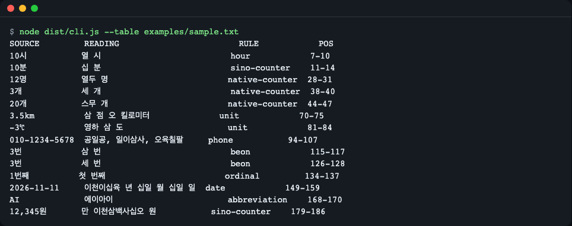
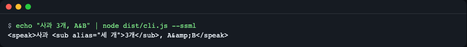
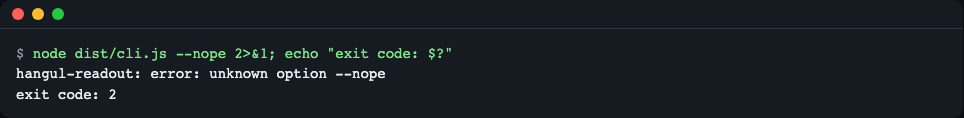
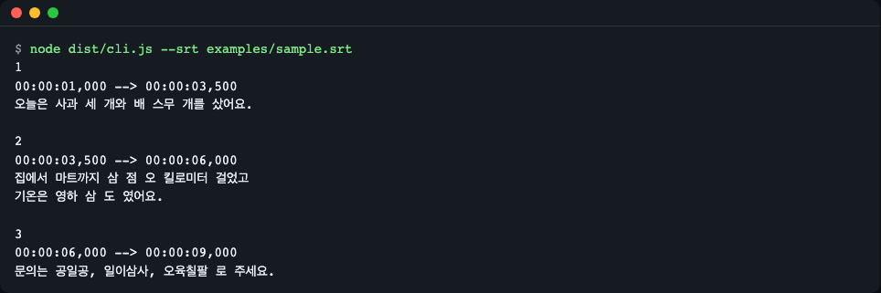
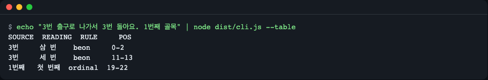
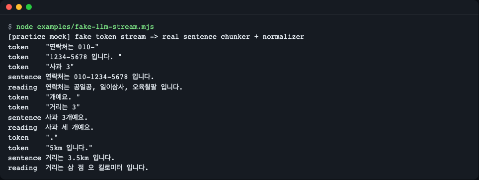
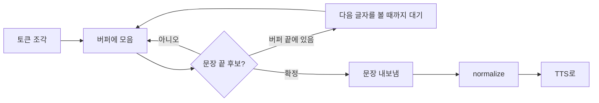

# hangul-readout

> **English summary** — A zero-dependency TypeScript library and CLI that rewrites Korean text the way a person reads it aloud, right before it goes to a TTS engine: `사과 3개` becomes `사과 세 개`, `3.5km` becomes `삼 점 오 킬로미터`, `010-1234-5678` becomes `공일공, 일이삼사, 오육칠팔`.
> It reports which spans changed (offsets in the original text and in the output), can emit SSML `<sub alias>`, and ships a sentence chunker so streaming LLM tokens such as `3` / `.` / `5km` are never misread.
> Install: `npm install github:LeeGyeongPil/hangul-readout` (Node >= 22.12, ESM only). Minimal use: `import { normalize } from "hangul-readout"; normalize("사과 3개").text`.

## 1. 소개

JS/TS로 한국어 음성 앱·음성 에이전트·내레이션 자동화를 만들 때, TTS에 문자열을 넘기기 **직전**에 숫자·단위·날짜를 "읽는 말"로 바꿔 주는 라이브러리입니다. 런타임 의존성이 없고, 키·네트워크·GPU 없이 오프라인으로 돕니다.

## 2. 무엇을 하나

TTS 엔진은 숫자와 단위를 엔진마다 다르게 읽습니다. `3개`를 "삼 개"로, `100kg`을 "백 케이지"로 읽는 식입니다. 이 라이브러리는 그 앞에서 글자를 먼저 바꿔 줍니다. 낭독자에게 줄 원고에 교정자가 연필로 "이건 이렇게 읽으세요"라고 적어 두는 일과 같습니다. 원고(자막)는 그대로 두고, 읽는 법만 따로 적습니다.

| 원문 | 이 라이브러리의 읽기 | 이유 |
|---|---|---|
| 사과 3개 | 사과 세 개 | 수량사 `개`는 고유어 수사 |
| 3년 | 삼 년 | 수량사 `년`은 한자어 수사 |
| 3.5km | 삼 점 오 킬로미터 | 소수와 단위 |
| 2.5배 | 이 점 오 배 | 소수와 수량사 |
| -3℃ | 영하 삼 도 | 음수 온도 |
| 010-1234-5678 | 공일공, 일이삼사, 오육칠팔 | 전화번호는 한 자리씩, 0은 "공" |
| 2026-11-11 | 이천이십육 년 십일 월 십일 일 | 날짜 |
| 3번 출구 / 3번 눌러 | 삼 번 출구 / 세 번 눌러 | `번`은 번호냐 횟수냐에 따라 |



*`node dist/cli.js --table examples/sample.txt` 의 출력 화면. 예문 파일에서 바뀐 곳만 표로 보여 줍니다.*

## 3. 빠른 시작

설치합니다. Node 22.12 이상이 필요합니다(전제 도구 설치 예: macOS `brew install node`, Debian/Ubuntu `sudo apt-get install -y nodejs npm git`).

```bash
npm install github:LeeGyeongPil/hangul-readout
```

npm 레지스트리 게시는 준비만 되어 있습니다(게시되면 `npm install hangul-readout`). 설치 중 `prepare` 스크립트가 `dist/`를 빌드하므로 git 설치에서도 바로 import 됩니다. npm 11 이상에서는 `prepare` 스크립트가 `allowScripts` 에 아직 없다는 경고가 나올 수 있습니다. 설치 실패가 아니며 빌드는 실행되어 바로 import 됩니다.

```js
import { normalize } from "hangul-readout";

const { text, spans } = normalize("사과 3개를 사서 3.5km를 걸었어요. 문의는 010-1234-5678");
console.log(text);
```

```text
사과 세 개를 사서 삼 점 오 킬로미터를 걸었어요. 문의는 공일공, 일이삼사, 오육칠팔
```

`text`를 TTS에 넘기고, 화면에 보이는 자막에는 원래 문자열을 그대로 씁니다. 설치한 프로젝트 안에서 명령줄로도 쓸 수 있습니다.

```bash
echo "사과 3개" | npx hangul-readout
```

```text
사과 세 개
```

저장소를 직접 받아 돌려 보려면 다음 명령입니다(설치부터 표 출력까지 몇 분 안에 끝납니다).

```bash
git clone https://github.com/LeeGyeongPil/hangul-readout.git
cd hangul-readout
npm ci
npm start
```

`npm start` 는 빌드한 뒤 `examples/sample.txt` 의 변경 표를 출력합니다. 위 화면이 그 결과입니다.

## 4. 사용법

### 4.1 `normalize` 와 span

`normalize(text, opts?)` 는 `{ text, spans }` 를 돌려줍니다. `spans` 는 "원문의 어디가 어떻게 바뀌었나"의 목록입니다.

```js
import { normalize } from "hangul-readout";

const r = normalize("사과 3개와 배 20개");
console.log(r.text);
console.log(JSON.stringify(r.spans[0]));
```

```text
사과 세 개와 배 스무 개
{"start":3,"end":5,"outStart":3,"outEnd":6,"source":"3개","reading":"세 개","rule":"native-counter"}
```

- `start`/`end`: 원문 안의 위치(UTF-16 offset, `String.prototype.slice` 와 같은 단위).
- `outStart`/`outEnd`: 결과 `text` 안의 위치.
- `source`/`reading`: 바뀌기 전 글자와 읽기. `rule`: 어떤 규칙이 골랐는지.

문자열이면 어떤 내용이든(빈 문자열, 이모지, 아주 긴 숫자) 예외를 던지지 않습니다. 문자열이 아닌 값을 넘기면 `HangulReadoutError` 를 던집니다(`normalize(null)` → `normalize(): expected a string, got null.`).

### 4.2 `toSSML`

SSML(음성 합성용 XML)을 받는 클라우드 TTS용입니다. 바뀐 곳을 `<sub alias="읽기">원문</sub>` 으로 감쌉니다. `& < > " '` 는 이스케이프합니다.

```js
import { toSSML } from "hangul-readout";
console.log(toSSML("사과 3개"));
```

```text
<speak>사과 <sub alias="세 개">3개</sub></speak>
```



*원문은 남기고 소리만 바꿉니다. `&` 는 XML 규칙대로 `&amp;` 가 됩니다.*

### 4.3 `sentences` 와 `normalizeStream` (LLM 스트림)

LLM은 답을 토큰 조각으로 보냅니다. `3` / `.` / `5km` 처럼 숫자 한가운데서 끊길 수 있습니다. `sentences` 는 조각을 모아 **문장이 확정된 뒤에** 내보내고, `normalizeStream` 은 거기에 `normalize` 까지 합칩니다. 입력은 `AsyncIterable<string>` 또는 `Iterable<string>` 입니다.

```js
import { sentences, normalizeStream } from "hangul-readout";

const tokens = ["거리는 3", ".", "5km 입니다", ". 다음은 ", "사과 3", "개예요. 끝"];

for await (const s of sentences(tokens)) console.log(s);
for await (const s of normalizeStream(tokens)) console.log(s.text);
```

```text
거리는 3.5km 입니다.
다음은 사과 3개예요.
끝
거리는 삼 점 오 킬로미터 입니다.
다음은 사과 세 개예요.
끝
```

`normalizeStream` 이 내는 값은 `{ sentence, text, spans }` 입니다. 시간 기반 flush(타임아웃)는 쓰지 않으므로 같은 입력이면 항상 같은 결과가 나옵니다. 동작 원리는 8절에서 설명합니다.

### 4.4 `createNormalizer` 와 옵션

옵션과 규칙을 한 번 만들어 두고 여러 번 쓰는 방법입니다. 호출마다 지역 상태만 쓰므로 스트림 여러 개를 동시에 돌려도 섞이지 않습니다.

```js
import { createNormalizer } from "hangul-readout";

const n = createNormalizer({
  counters: { native: ["포기"] },
  abbreviations: { RAG: "래그" },
  units: { "㎡": "제곱미터" },
});
console.log(n.normalize("배추 3포기, RAG 30㎡").text);
```

```text
배추 세 포기, 래그 삼십 제곱미터
```

| 옵션 | 기본값 | 뜻 |
|---|---|---|
| `over99` | `"mixed"` | 고유어 수량사에서 100 이상을 읽는 방식(5절) |
| `counters` | 내장 표 | `{ native?: string[]; sino?: string[] }` 수량사를 덧붙임 |
| `units` | 내장 표 | `{ "㎡": "제곱미터" }` 단위 기호 → 읽기 |
| `abbreviations` | 내장 표 | `{ RAG: "래그" }` 영문 약어 → 읽기 |
| `beonNumberHints` | 내장 목록 | `번` 뒤에 오면 번호(한자어)로 읽는 낱말 |
| `disable` | 없음 | 끌 규칙 이름 배열 |

청크 옵션 `minChars`(기본 8)·`maxChars`(기본 160)는 `sentences` 와 `normalizeStream` 에서 씁니다. 공백이 전혀 없는 긴 텍스트는 `max(maxChars*8, 2048)` 자에서 강제로 자릅니다.

### 4.5 CLI

```text
hangul-readout [options] [file | -]
```

파일을 주지 않거나 `-` 를 주면 표준입력을 읽습니다.

| 옵션 | 하는 일 |
|---|---|
| (없음) | 읽기로 바꾼 텍스트를 출력 |
| `--json` | `{ text, spans }` 를 JSON 으로 출력 |
| `--table` | 바뀐 곳 표(원문·읽기·규칙·위치) 출력 |
| `--ssml` | `<sub alias>` SSML 출력 |
| `--srt` | 입력을 SRT 로 보고 번호·시간 줄은 두고 대사만 바꿈 |
| `--over99 <m>` | `mixed`(기본) 또는 `sino` |
| `--debug` | 오류 때 스택 출력 |
| `--help`, `--version` | 도움말, 버전 |

| 종료코드 | 뜻 |
|---|---|
| 0 | 정상(빈 입력도 정상) |
| 2 | 모든 오류: 알 수 없는 옵션, 없는 파일, 잘못된 `--over99` 값, 깨진 SRT 등 |

오류는 stderr 한 줄(`hangul-readout: error: …`)로만 나오고 스택은 `--debug` 를 줄 때만 나옵니다.

```bash
node dist/cli.js --nope 2>&1; echo "exit code: $?"
```

```text
hangul-readout: error: unknown option --nope
exit code: 2
```



*오류 사례 화면. 트레이스백 없이 한 줄만 나오고 종료코드는 2입니다.*

SRT 자막 파일은 대사만 읽기로 바꿔 줍니다.

```bash
node dist/cli.js --srt examples/sample.srt
```

```text
1
00:00:01,000 --> 00:00:03,500
오늘은 사과 세 개와 배 스무 개를 샀어요.

2
00:00:03,500 --> 00:00:06,000
집에서 마트까지 삼 점 오 킬로미터 걸었고
기온은 영하 삼 도 였어요.

3
00:00:06,000 --> 00:00:09,000
문의는 공일공, 일이삼사, 오육칠팔 로 주세요.
```



*결과를 파일로 저장하려면 `npx hangul-readout --srt narration.srt > narration.read.srt`.*

## 5. 읽기 규칙

스캐너가 글을 왼쪽에서 오른쪽으로 훑다가 숫자를 만나면, 아래 규칙을 **위에서부터** 시도합니다. 맞는 첫 규칙이 읽기를 정하고, 규칙이 "내 것이 아니다" 하고 거절하면 다음 규칙으로 넘어갑니다. 그래서 순서가 곧 모호성 해결입니다(전화번호가 일반 숫자보다 먼저).

| 순서 | 규칙 | 예 → 읽기 |
|---|---|---|
| 1 | `phone` | 010-1234-5678 → 공일공, 일이삼사, 오육칠팔 (대표번호 1588-1234, `(02) 123-4567`, `+82-10-…`, 긴급번호 119 도) |
| 2 | `date` | 2026-11-11 → 이천이십육 년 십일 월 십일 일, 11/11 → 십일 월 십일 일 |
| 3 | `protect` | 192.168.0.1, 1.2.3, `https://…` → 통째로 그대로 |
| 4 | `clock` | 3:30 → 세 시 삼십 분 |
| 5 | `ratio` | 16:9 → 십육 대 구, 1:1 → 일 대 일 |
| 6 | `fraction` | 1/3 → 삼분의 일 |
| 7 | `range` | 2~3명 → 두세 명, 5~6시 → 다섯 시에서 여섯 시, 30~40% → 삼십에서 사십 퍼센트 |
| 8 | `unit` | 3.5km → 삼 점 오 킬로미터, -3℃ → 영하 삼 도, 30°C → 삼십 도 |
| 9 | `currency` | $5 → 오 달러, ₩5000 → 오천 원, ₩5,000원 → 오천 원 |
| 10 | `month` | 6월 → 유월, 11월 → 십일 월 |
| 11 | `hour` | 10시 → 열 시 (`시간` 은 제외) |
| 12 | `ordinal` | 1번째 → 첫 번째, 2번째 → 두 번째 |
| 13 | `beon` | 3번 출구 → 삼 번 출구 / 3번 눌러 → 세 번 눌러 |
| 14 | `native-counter` | 3개 → 세 개 |
| 15 | `sino-counter` | 3년 → 삼 년, 20세 → 이십 세, 제1장 → 제일 장, 30대 → 삼십 대. 소수는 고유어 수량사 앞에서도 한자어로 읽음: 1.5배 → 일 점 오 배, 2.5시간 → 이 점 오 시간 |
| 16 | `digits` | 17자리 이상·0으로 시작하는 숫자열 → 한 자리씩 |
| 17 | `number` | 12,345 → 만 이천삼백사십오 |
| - | `abbreviation` | AI → 에이아이, 5G → 파이브지 |

**고유어냐 한자어냐는 숫자가 아니라 뒤에 오는 단위가 정합니다.** `3개` 는 "세 개", `3년` 은 "삼 년"입니다. 그래서 숫자만 바꿔 주는 함수로는 문장을 처리할 수 없고, 숫자 뒤의 수량사를 같이 봐야 합니다.

**99 초과 옵션.** 고유어로 100 이상을 읽는 방법은 정해진 답이 없어서 옵션으로 고릅니다.

```js
import { normalize } from "hangul-readout";
console.log(normalize("120명").text, normalize("120명", { over99: "sino" }).text);
```

```text
백스무 명 백이십 명
```

몇 가지 예외도 규칙 안에 들어 있습니다.

```js
console.log(normalize("6월 10월 11월").text, normalize("3시간 3시").text);
console.log(normalize("A4 용지 3장 COVID-19").text);
```

```text
유월 시월 십일 월 세 시간 세 시
A4 용지 세 장 COVID-19
```

- `6월`·`10월` 은 "유월"·"시월" 입니다.
- `3시간` 의 `3` 은 "세", `시간` 이 단위이므로 `hour` 규칙이 아니라 수량사 규칙이 처리합니다.
- 영문에 붙은 숫자(`A4`, `MP3`, `COVID-19`, `v2.0`)는 건드리지 않습니다. 숫자가 앞에 오는 `5G`·`3D`·`4K` 는 약어 표에 있으면 통째로 읽고(`5G` → 파이브지), 없으면(`1st`, `1e5`) 통째로 그대로 둡니다. 반쪽만 바꾸는 일은 없습니다.
- `제1장` → 제일 장, `20대` → 이십 대, `2대`(차량) → 두 대. `제`+숫자는 한자어, 10의 배수+`대`는 연령대로 읽습니다.
- 범위는 양쪽이 같은 수량사·단위를 공유할 때만 읽고(`5~6시` → 다섯 시에서 여섯 시), 읽을 수 없으면 `1~2.5명` 처럼 통째로 그대로 둡니다.

```js
console.log(normalize("5~6시 30~40% 1~2만 원").text);
console.log(normalize("30°C 5G $5 11/11 16:9").text);
console.log(normalize("1588-1234 (02) 123-4567 +82-10-1234-5678").text);
```

```text
다섯 시에서 여섯 시 삼십에서 사십 퍼센트 일에서 이만 원
삼십 도 파이브지 오 달러 십일 월 십일 일 십육 대 구
일오팔팔, 일이삼사 (공이), 일이삼, 사오육칠 플러스 팔이, 일공, 일이삼사, 오육칠팔
```

`번` 은 문맥으로 가립니다. 바로 뒤에 번호 힌트 낱말(출구·버스·선·게이트·트랙·승강장·홈·문제·채널·방·국도·타자·라인)이 오거나 앞이 `호선`·`번호는`·`정답은` 이면 번호(한자어)로, 그 밖에는 횟수(고유어)로 읽습니다.



*`3번 출구` 는 "삼 번", `3번 돌아요` 는 "세 번", `1번째` 는 "첫 번째"가 됩니다.*

## 6. 내 규칙 덧붙이기

`normalize` 와 `createNormalizer` 에 옵션을 주면 내장 표에 덧붙습니다.

```js
import { normalize } from "hangul-readout";

console.log(normalize("3번 주차장").text);
console.log(normalize("3번 주차장", { beonNumberHints: ["주차장"] }).text);
console.log(normalize("AI 모델", { disable: ["abbreviation"] }).text);
```

```text
세 번 주차장
삼 번 주차장
AI 모델
```

- `counters`: 수량사를 고유어/한자어로 추가합니다(`{ native: ["포기"] }`).
- `units`: 단위 기호를 추가합니다(`{ "㎡": "제곱미터" }`).
- `abbreviations`: 약어를 추가합니다(`{ RAG: "래그" }`). 대소문자를 구분합니다.
- `beonNumberHints`: `번` 을 번호로 읽게 하는 낱말을 추가합니다.
- `disable`: 규칙 이름(`RuleName`)을 주면 그 규칙을 끕니다. 이름은 `phone`, `date`, `protect`, `clock`, `ratio`, `fraction`, `range`, `unit`, `currency`, `month`, `hour`, `ordinal`, `beon`, `native-counter`, `sino-counter`, `digits`, `number`, `abbreviation` 입니다.
- `abbreviations` 의 키는 `{ "6G": "식스지" }` 처럼 숫자로 시작해도 됩니다.

애매한 문장을 찾으면 `test/golden.json` 에 한 줄 더해 고정하는 방법도 있습니다(11절).

## 7. 원문-읽기 정렬(span)과 자막

음성에는 읽기를, 화면에는 원문을 쓰고 싶을 때 span 이 두 문자열을 이어 줍니다. span 은 "원문의 이 구간이 읽기의 저 구간"이라는 대응표이고, `toSSML` 의 `<sub alias>` 는 같은 생각을 XML로 적은 것입니다.

offset 단위는 UTF-16 코드 유닛입니다. 이모지는 두 칸을 차지하는데, 그래도 `input.slice(start, end)` 가 그대로 `source` 가 됩니다.

```js
import { normalize } from "hangul-readout";

const input = "👍 사과 3개";
const e = normalize(input);
const s = e.spans[0];
console.log(JSON.stringify(s));
console.log(input.slice(s.start, s.end), "->", e.text.slice(s.outStart, s.outEnd));
```

```text
{"start":6,"end":8,"outStart":6,"outEnd":9,"source":"3개","reading":"세 개","rule":"native-counter"}
3개 -> 세 개
```

`start` 가 6인 까닭: 이모지 👍 이 2칸(UTF-16 코드 유닛 2개), 공백 1칸, `사과` 2칸, 공백 1칸이라 `3개` 가 6번째에서 시작합니다. 이모지·ZWJ 시퀀스·짝 없는 서로게이트가 섞여도 `slice` 가 맞도록 테스트로 고정되어 있습니다.

자막 강조 예: 원문 안에서 `[start, end)` 구간만 `<mark>` 로 감싸면 "읽기가 바뀐 곳"을 자막에 표시할 수 있고, `outStart`/`outEnd` 를 쓰면 음성 타이밍 쪽 문자열의 같은 곳을 찾을 수 있습니다.

## 8. 스트리밍: 청크 경계를 어떻게 지키나

> **연습용 가짜 LLM 스트림입니다.** `examples/fake-llm-stream.mjs` 는 실제 모델이 아니라 숫자 한가운데서 끊긴 고정 토큰 조각을 흘려보내는 연습용(mock) 예제입니다. 문장을 자르고 읽기로 바꾸는 부분은 실제 라이브러리 코드이고, 출력은 라이브러리를 실제로 통과한 결과입니다. 실제 LLM·TTS 호출은 이 저장소의 예제와 테스트에 들어 있지 않습니다.

```bash
node examples/fake-llm-stream.mjs
```

```text
[practice mock] fake token stream -> real sentence chunker + normalizer
token    "연락처는 010-"
token    "1234-5678 입니다. "
token    "사과 3"
sentence 연락처는 010-1234-5678 입니다.
reading  연락처는 공일공, 일이삼사, 오육칠팔 입니다.
token    "개예요. "
token    "거리는 3"
sentence 사과 3개예요.
reading  사과 세 개예요.
token    "."
token    "5km 입니다."
sentence 거리는 3.5km 입니다.
reading  거리는 삼 점 오 킬로미터 입니다.
```



*`입니다. ` 가 들어온 뒤에도 바로 문장을 내보내지 않고, 다음 토큰 `사과 3` 이 온 뒤에야 앞 문장이 나옵니다.*



- **lookahead**: 문장 끝 후보(`.`, `?`, `!` 등)가 버퍼 맨 끝에 있으면 다음 글자를 볼 때까지 확정을 미룹니다. `3` 뒤에 `.` 가 오고 그다음에 `5` 가 오면 소수점이었다는 것을 알 수 있기 때문입니다.
- **소수점·목록 번호**: 숫자 사이 마침표(`3.5`)와 목록 번호(`1. `)는 문장 끝으로 보지 않습니다. 말줄임표도 경계로 보지 않습니다. 줄바꿈은 항상 문장 끝입니다.
- **`maxChars`**: 한 문장이 너무 길면 쉼표·공백에서 강제로 나누되, `010-1234-5678`·`3.5km`·`2~3명` 같은 숫자·기호 토큰 안에서는 자르지 않습니다.

```js
import { sentences } from "hangul-readout";

const text = "연락처는 010-1234-5678 이고, 거리는 3.5km, 인원은 2~3명입니다.";
const out = [];
for await (const s of sentences([text], { maxChars: 12 })) out.push(s);
console.log(JSON.stringify(out));
```

```text
["연락처는","010-1234-5678","이고, 거리는","3.5km, 인원은","2~3명입니다."]
```

토큰이 어떻게 쪼개져 들어와도(한 글자씩이어도) 같은 문장이 나옵니다. 이 성질은 테스트로 고정되어 있습니다. 문장을 확정한 뒤에 정규화하는 순서가 청크 경계 오독을 막는 핵심입니다.

## 9. 한계와 애매한 읽기

정해진 답이 없는 읽기가 있습니다. 기본값을 정하고, 옵션과 골든 표로 바꿀 수 있게 했습니다.

- **`번`**: 기본은 횟수(고유어)입니다. 번호로 읽을 낱말은 힌트 목록과 `beonNumberHints` 로만 늘어납니다. `3번 방법` 은 횟수로 읽습니다.
- **조사 일치 미보정**: 읽기가 바뀌어도 뒤의 조사는 바꾸지 않습니다. `3개를` → `세 개를` 은 맞지만 받침이 달라지는 경우(`1명이` → `한 명이` 등)에 조사를 읽기에 맞게 고쳐 주지 않습니다.
- **범위 수량사**: `2~3명` → `두세 명`, `5~6시` → `다섯 시에서 여섯 시` 는 되지만 `2~3일` 은 `이에서 삼 일` 로 읽습니다(자연스러운 `이삼 일` 아님). 읽을 수 없는 범위(`1~2.5명`, `01~02월`)는 통째로 그대로 두고, 하이픈 꼬리가 없는 `2-3` 은 범위로 보지 않습니다.
- **`대`**: `20대의 서버`처럼 실제 대수가 정확히 10의 배수(10~90)이면 연령대로 읽습니다. `2대`·`5대`·`100대` 는 차량(고유어)입니다.
- **날짜처럼 보이는 `NN/NN`**: 두 쪽 모두 두 자리이고 월 ≤ 12, 일 ≤ 31 일 때만 날짜입니다. `1/2`·`3/4` 는 분수입니다.
- **통화**: 기호와 숫자, 그리고 바로 붙은 같은 통화 이름을 함께 읽습니다(`$5`, `₩5000`, `₩5,000원`, `$5달러`는 이름을 한 번만 읽습니다). 공백을 둔 `₩5,000 원` 은 기호와 숫자만 읽고 뒤의 이름은 따로 읽으므로 이름이 두 번 나옵니다(`오천 원 원`). 기호와 다른 통화 이름(`$5원`)은 흡수하지 않습니다(`오 달러원`).
- **마크다운 기호는 지우지 않습니다.** `**3**개` → `**세** 개` 처럼 숫자와 수량사 사이의 `*`·`_`·`` ` `` 는 건너뛰고 읽지만, 기호는 출력에 그대로 남습니다. TTS가 `**` 를 "별표"로 읽을 수 있으므로 기호 제거는 호출하는 쪽에서 하세요.
- **아주 긴 낱말**: 공백이 없는 텍스트가 `max(maxChars*8, 2048)` 자를 넘으면(긴 URL·base64 등) 중간에서 잘립니다.
- **개월·석 달·인분**: 석 달·넉 장 같은 옛 형태는 지원하지 않습니다.
- **사전에 없는 단위·약어**: 내장 표는 작은 기본값입니다. 표에 없는 낱말(`GPT-4` 등)은 그대로 두며, `units`·`abbreviations` 로 추가합니다.
- **공백·줄바꿈**: 단위 앞 한 칸 공백은 허용(`5 km`)하지만 두 칸 이상이나 줄바꿈은 연결하지 않습니다.
- **날짜 표기·버전**: `1.2.3`·`192.168.0.1` 같은 버전·IP 와 URL 은 통째로 그대로 둡니다. `2026. 11. 11.` 처럼 공백이 들어간 날짜는 스트림에서 `2026.` 에서 끊길 수 있습니다.
- 일부 모호한 읽기(`3대 1` → `세 대 일`)는 규칙 기반의 한계입니다.
- 발음 변환(연음·경음화), 한자 독음, 형태소 분석은 하지 않습니다.
- Node 22.12.0 과 26.13.0 에서 예제·테스트(279개)·typecheck 가 통과했고, CI 매트릭스(22·24·26)가 계속 확인합니다.
- **알려진 한계(코드 수정 대기)**: `~`·`-` 범위 기호의 일부 조합은 범위로 읽지 않거나 어색하게 읽습니다. `제 3개` 처럼 "제" 뒤 띄어 쓴 숫자에 서수 읽기가 과하게 적용될 수 있습니다. `4강` 같은 일부 수량사와 `+82` 국가번호 단독 표기의 읽기가 자연스럽지 않을 수 있습니다.

## 10. 기존 대안과 비교

기능 표는 만들지 않습니다. 다른 도구의 기능은 바뀌므로 아래는 확인한 날짜와 목적만 적습니다. (모두 2026-11-11 확인)

- **숫자 하나를 한글로 바꾸는 함수**가 필요하면 [es-hangul](https://github.com/toss/es-hangul)(2.4.0)이나 [korean-number-count](https://socket.dev/npm/package/korean-number-count)(1.0.0)가 목적에 맞습니다. 이 라이브러리는 그 위에서 "문장 안에서 숫자를 찾고, 뒤 수량사를 보고 읽기를 고른다"를 맡습니다. 수사 1~99는 es-hangul 과 같은 값이 나오는지 테스트에서 비교합니다.
- **Python 쪽 음성 파이프라인**이면 [NeMo-text-processing](https://github.com/NVIDIA/NeMo-text-processing)이 한국어 규칙을 갖고 있습니다. 파이썬과 pynini 기반이라 브라우저·Node·엣지에서는 쓰기 어렵습니다.
- **범용 다국어 정규화**가 필요하면 @revolab/revonorm(npm 패키지)을 볼 수 있습니다. 확인한 1.1.4 버전은 한국어(`ko`) 호출에서 에러가 났습니다.
- **음성 프레임워크의 문장 분할기**([Pipecat](https://reference-server.pipecat.ai/en/latest/_modules/pipecat/utils/text/simple_text_aggregator.html), [LiveKit Agents](https://docs.livekit.io/reference/python/livekit/agents/tokenize/basic.html))는 언어 일반용으로, 한국어 숫자 읽기와는 별개입니다.

## 11. 개발

```bash
npm ci && npm run typecheck && npm test
```

`npm test` 는 `pretest` 로 빌드한 뒤 `vitest run` 을 실행합니다. 모든 테스트는 오프라인으로 결정적으로 돌고, 키가 필요 없습니다. 이 저장소에서 확인한 결과는 `Test Files 10 passed`, `Tests 279 passed` 입니다.

**골든 행 추가**: `test/golden.json` 은 `{ "input", "expected", "options"?, "note"? }` 의 배열입니다(현재 147행). 틀리게 읽는 문장을 찾으면 한 줄 추가하고 `npx vitest run test/golden.test.ts` 로 확인합니다. 행마다 테스트 이름이 원문입니다.

```json
{ "input": "사과 3개", "expected": "사과 세 개", "note": "native counter takes the attributive form" }
```

- 지원 Node: `>=22.12`, ESM 전용. CI는 Node 22·24·26에서 `npm ci` → `npm run typecheck` → `npm test` 를 실행합니다.
- 빌드는 `tsc -p tsconfig.build.json` 으로만 합니다(`npm run build`).
- 버전은 유의적 버전(SemVer)을 따르고, 0.x 동안은 마이너 버전에서 API가 바뀔 수 있습니다. 변경은 [CHANGELOG.md](CHANGELOG.md)에 적습니다.
- 보안 문제 제보는 [SECURITY.md](SECURITY.md)를 참고하세요.

## 12. 라이선스

MIT. [LICENSE](LICENSE) 참고. 수량사·단위·예외 표와 예문은 공개된 규칙 설명을 참고해 직접 작성했습니다.
